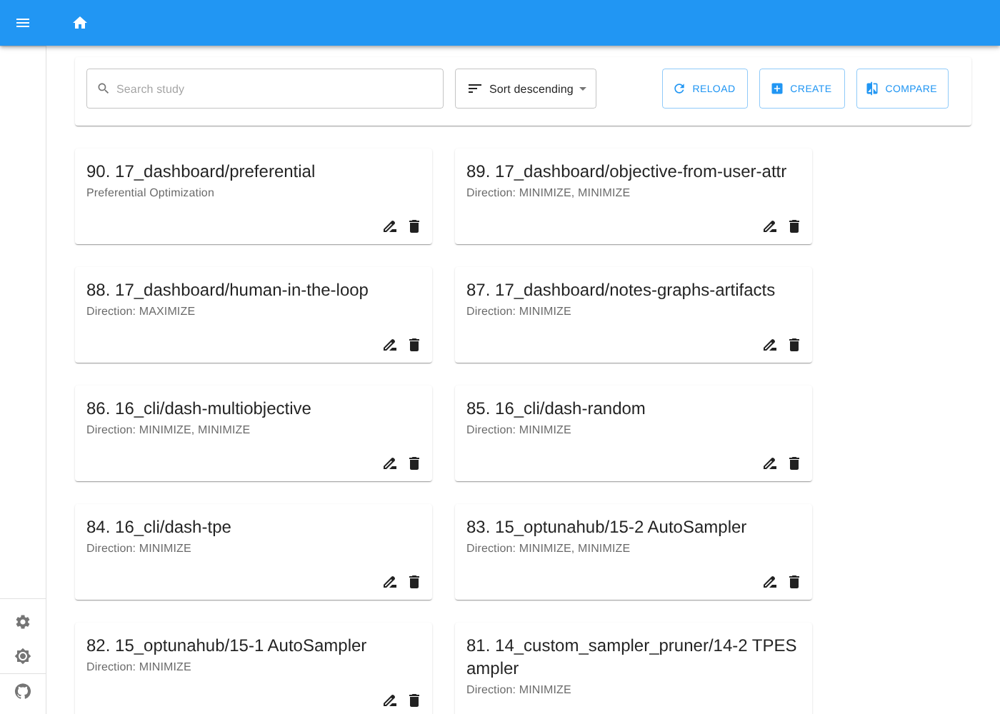
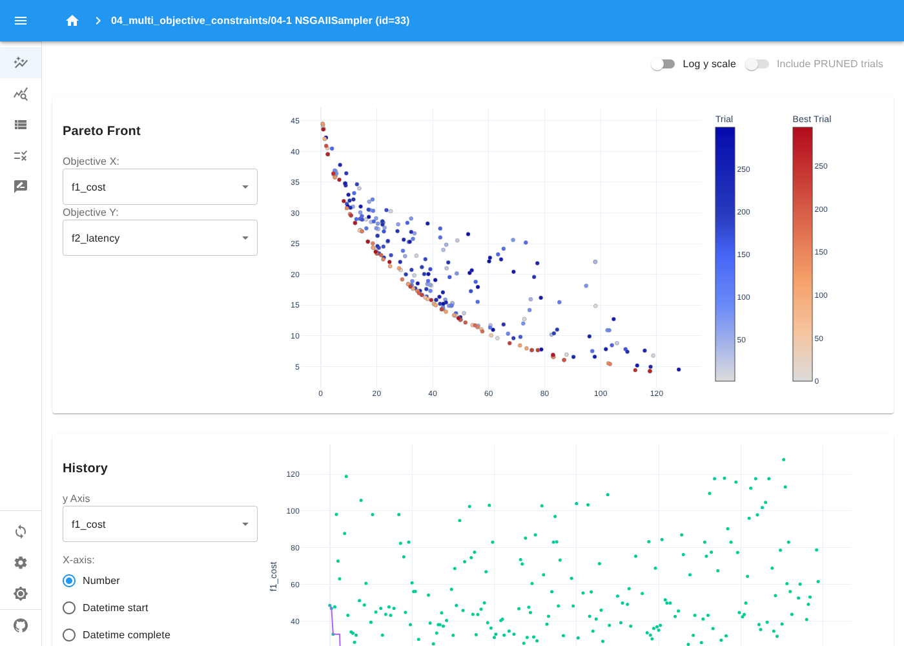
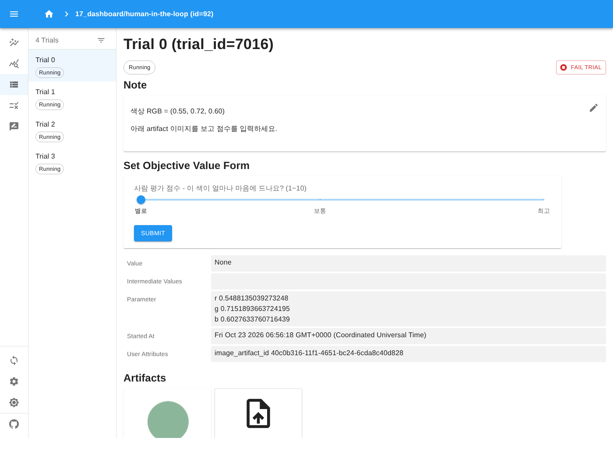
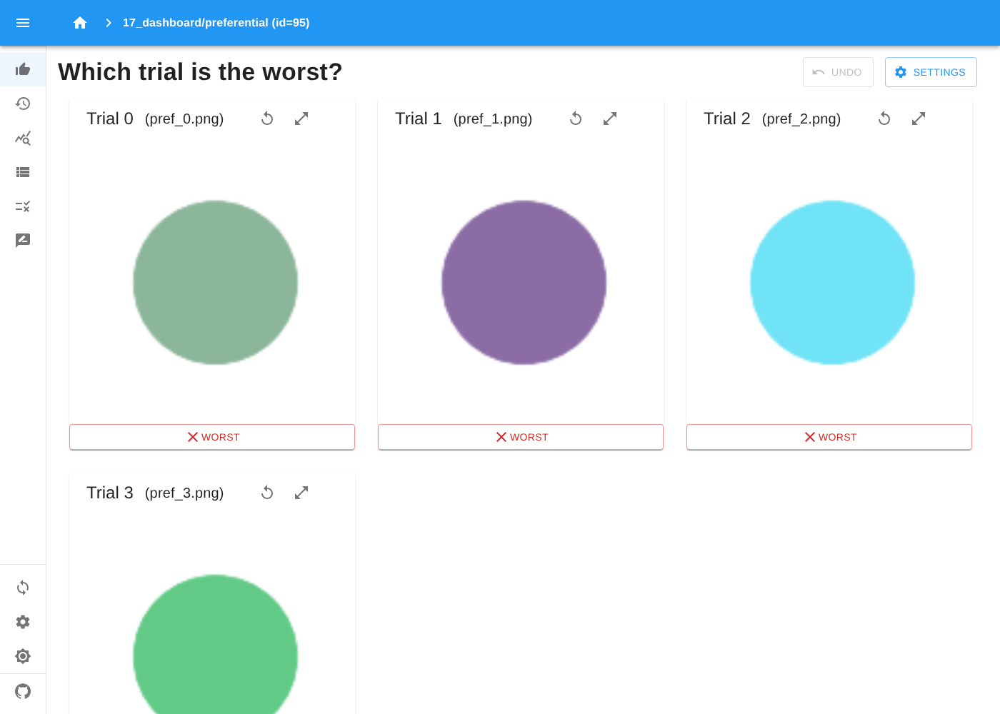

# Optuna 기능 테스트 예제 모음

Optuna(**v5.0.0** 기준)의 기능 전반을 기능별 스크립트로 나눠 테스트하는 예제입니다.
각 스크립트는 독립 실행되며, 결과 파일(CSV, HTML/PNG 그래프, SQLite DB, artifact)은 `outputs/` 에 생성됩니다.

## 설치 & 실행

```bash
python -m venv .venv
# Windows: .venv\Scripts\activate   /   Linux·macOS: source .venv/bin/activate
pip install -r requirements.txt

python run_all.py            # 전체 실행 + 요약 (약 4분, study 는 메모리에만 존재)
python run_all.py 02 08      # 번호로 일부만 실행
cd examples && python 01_basic_quickstart.py   # 개별 실행

# Optuna Dashboard 로 결과 보기
python run_all.py --dashboard   # 모든 study 를 outputs/dashboard.log 에 저장하며 실행 (약 5분)
python dashboard.py             # → http://127.0.0.1:8080
```

> `torch`(GPSampler), `optuna-integration`/`lightgbm`(12), `optunahub`(15) 가 없으면 해당 부분만 건너뜁니다.
> 15번(OptunaHub)은 실행 시 GitHub 에서 패키지를 내려받으므로 인터넷 연결이 필요합니다.

## 예제 구성

| # | 파일 | 다루는 기능 |
|---|------|-------------|
| 01 | `01_basic_quickstart.py` | `create_study`, `optimize`, `best_*`, `suggest_float/int/categorical` (log, step), 조건부·동적 탐색 공간(Define-by-Run), `trials_dataframe`, maximize |
| 02 | `02_samplers.py` | TPE(multivariate, group, n_startup_trials), Random, CMA-ES(popsize, separable, with_margin), **GPSampler**, QMC(Sobol/Halton), Grid, BruteForce, NSGA-II/III, PartialFixed, 샘플러 pickle |
| 03 | `03_pruners.py` | `report`/`should_prune`/`TrialPruned`, Median, Percentile, SuccessiveHalving, Hyperband, Threshold, Patient, **Wilcoxon**, Nop |
| 04 | `04_multi_objective_constraints.py` | 다목적(`directions`, `best_trials`, `set_metric_names`), **`trial.set_constraint`(v5 제약조건 API)**, NSGA-II crossover 6종, 3목적, 하이퍼볼륨, 파레토 시각화 |
| 05 | `05_storage_and_parallel.py` | RDB(SQLite), JournalStorage(File), resume/`load_study`/`copy_study`/`delete_study`/summaries, `n_jobs`, 멀티프로세스 분산, heartbeat + `RetryHeartbeatStaleTrialCallback`, gRPC 프록시 안내 |
| 06 | `06_ask_tell_and_trials.py` | Ask-and-Tell, define-and-run(`ask(fixed_distributions)`), 배치 평가, tell 상태(PRUNED/FAIL), `enqueue_trial`, `add_trial(s)`+`create_trial`, `FixedTrial` |
| 07 | `07_callbacks_and_control.py` | 사용자 콜백(조기 종료), `MaxTrialsCallback`, `study.stop()`, `timeout`, `catch`, user_attrs, `gc_after_trial`, `show_progress_bar`, 로깅 제어 |
| 08 | `08_visualization.py` | plotly/matplotlib 전체 plot: history(비교, error_bar), intermediate, parallel_coordinate, contour, slice, importances, edf, rank, timeline |
| 09 | `09_param_importance.py` | PED-ANOVA(기본), fANOVA, MDI 중요도, `params`/`target`/`normalize` 옵션 |
| 10 | `10_terminator.py` | Terminator(RegretBound, EMMR, BestValueStagnation / CV, Static, Median error), `report_cross_validation_scores`, `plot_terminator_improvement` *(v4.9 부터 deprecated)* |
| 11 | `11_artifacts.py` | `FileSystemArtifactStore`, `Backoff`, `upload_artifact`(trial/study), `get_all_artifact_meta`, `download_artifact` |
| 12 | `12_ml_sklearn_lightgbm.py` | 실전 튜닝: 모델 선택+CV, LightGBM + `LightGBMPruningCallback`, `OptunaSearchCV`, `LightGBMTunerCV` |
| 13 | `13_distributions_search_space.py` | Distribution 객체/JSON 직렬화/호환성, internal·external 표현, `IntersectionSearchSpace`, trial 필터링, multi-index DataFrame |
| 14 | `14_custom_sampler_pruner.py` | `BaseSampler` 상속(Simulated Annealing), `BasePruner` 상속 |
| 15 | `15_optunahub.py` | `optunahub.load_module("samplers/auto_sampler")` — AutoSampler (단일/다목적) |
| 16 | `16_cli_and_dashboard.py` | `optuna` CLI(create-study, ask/tell, studies, trials, best-trial, set-user-attr), 대시보드용 study 생성 |
| 17 | `17_dashboard_features.py` | **대시보드 전용 기능**: `save_note`, `save_plotly_graph_object`, artifact 미리보기, Human-in-the-loop(`register_objective_form_widgets`, `ObjectiveUserAttrRef`), `register_user_attr_form_widgets`, Preferential optimization |

## Optuna Dashboard 연동

대시보드는 **스토리지에 저장된 study 만** 보여줍니다. 예제는 기본적으로 메모리(InMemoryStorage)에서
돌기 때문에, `--dashboard` 옵션으로 실행해야 대시보드에 나타납니다.

```bash
python run_all.py --dashboard        # 또는 일부만: python run_all.py --dashboard 02 04 17
python dashboard.py                  # 옵션: --port 8081 --host 0.0.0.0
# CLI 로 직접: optuna-dashboard outputs/dashboard.log --artifact-dir outputs/artifacts
```

- `--dashboard` 이면 `examples/common.py` 가 `optuna.create_study()` 를 감싸서, storage 를 지정하지 않은
  모든 study 를 `outputs/dashboard.log` 에 저장합니다. 예제 코드는 수정할 필요가 없습니다.
- study 이름은 `<예제파일>/<섹션번호> <샘플러>` 형식입니다 (예: `02_samplers/02-1 GPSampler`).
  재실행하면 같은 이름의 study 는 지우고 새로 만듭니다.
- 스토리지는 **JournalStorage(파일)** 를 씁니다. 이 예제 기준으로 SQLite 보다 약 7배 빠르고(전체 실행 약 5분 vs 10분),
  Windows 에서도 동작하도록 `JournalFileOpenLock` 을 사용합니다.
- artifact(이미지, CSV, 모델)는 `outputs/artifacts/` 에 저장되고, `dashboard.py` 가 같은 위치를 연결해서
  대시보드에서 미리보기·다운로드할 수 있습니다.

### 17번 예제에서 해볼 것

| study | 대시보드에서 할 일 |
|-------|-------------------|
| `17_dashboard/notes-graphs-artifacts` | study/trial 노트(Markdown) 보기·편집, 사용자 정의 그래프, trial 별 CSV artifact 미리보기 |
| `17_dashboard/human-in-the-loop` | RUNNING 상태 trial 의 색상 이미지를 보고 **슬라이더로 점수 입력 → trial 완료** |
| `17_dashboard/objective-from-user-attr` | 목적 2개 중 1개는 코드가 계산한 값(`ObjectiveUserAttrRef`), 1개는 사람이 선택 |
| `17_dashboard/user-attr-form` | 완료된 trial 에 코멘트/리뷰 결과(user_attr) 입력 |
| `17_dashboard/preferential` | 후보 이미지 중 **가장 나쁜 것(WORST)** 을 골라 선호도 기록 |

> 참고: objective 입력 폼과 user_attr 입력 폼은 같은 저장 키를 써서 한 study 에 둘 중 하나만 등록할 수 있습니다.

### 화면 예시

| study 목록 | 다목적 파레토 프론트 (04) |
|---|---|
|  |  |
| **Human-in-the-loop (17)** | **Preferential optimization (17)** |
|  |  |

## v5.0 에서 확인된 변경/주의 사항

예제 작성 중 실제로 경고가 발생한 항목이며, 예제는 모두 새 방식으로 작성했습니다.

| 기존 방식 | v5 권장 방식 |
|-----------|--------------|
| `Sampler(constraints_func=...)` (v5.0 deprecated) | 목적함수 안에서 `trial.set_constraint("name", value)` |
| `RDBStorage(failed_trial_callback=RetryFailedTrialCallback())` (v4.9 deprecated) | `heartbeat_stale_trial_callback=RetryHeartbeatStaleTrialCallback()` |
| `CmaEsSampler(restart_strategy="ipop")` (v4.4 deprecated) | OptunaHub 의 CMA-ES 패키지 |
| `optuna.terminator` (v4.9 deprecated, v6.0 제거 예정) | 아직 동작함 — 향후 OptunaHub 로 이전 |
| 중요도 기본 평가기 fANOVA | PED-ANOVA (`PedAnovaImportanceEvaluator`) |
| `optuna_dashboard.set_objective_names(study, names)` (deprecated) | `study.set_metric_names(names)` |
| `TPESampler(constant_liar=False)` 기본값 | `constant_liar=True` 기본값 (병렬 최적화에 유리) |

## 폴더 구조

```
Optuna_test/
├── README.md
├── requirements.txt
├── run_all.py            # 전체 실행 + 요약 (--dashboard 옵션)
├── dashboard.py          # Optuna Dashboard 실행 (dashboard.log + artifacts 연결)
├── docs/images/          # 대시보드 화면 예시
├── examples/
│   ├── common.py         # 공통 유틸(출력 경로, 벤치마크 함수, 대시보드 스토리지 연동)
│   └── 01_ ~ 17_*.py
└── outputs/              # 실행 결과 (git 제외)
    ├── dashboard.log     # --dashboard 실행 시 모든 study
    └── artifacts/        # artifact 파일
```
